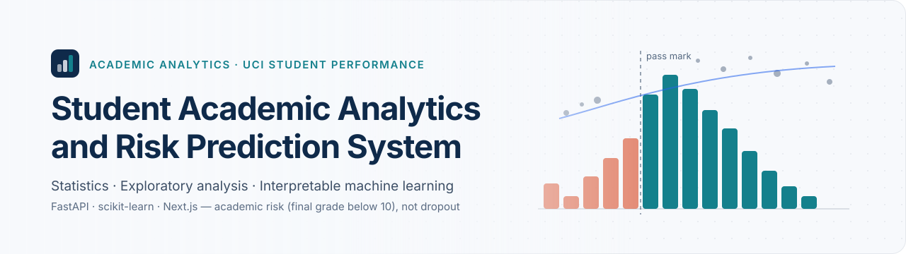
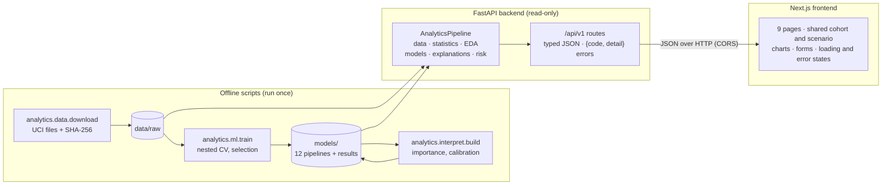
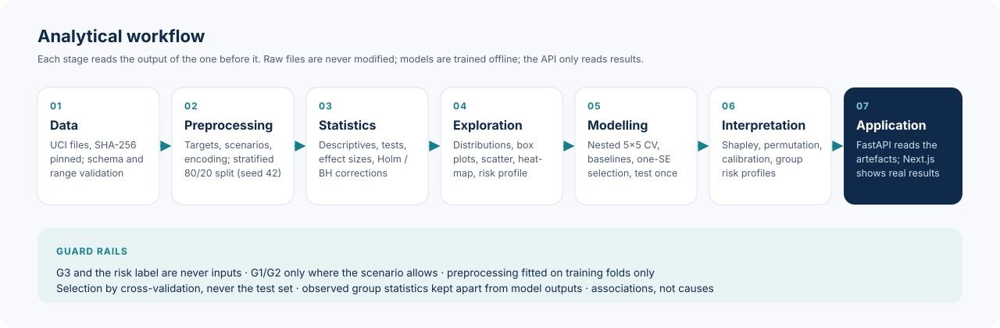
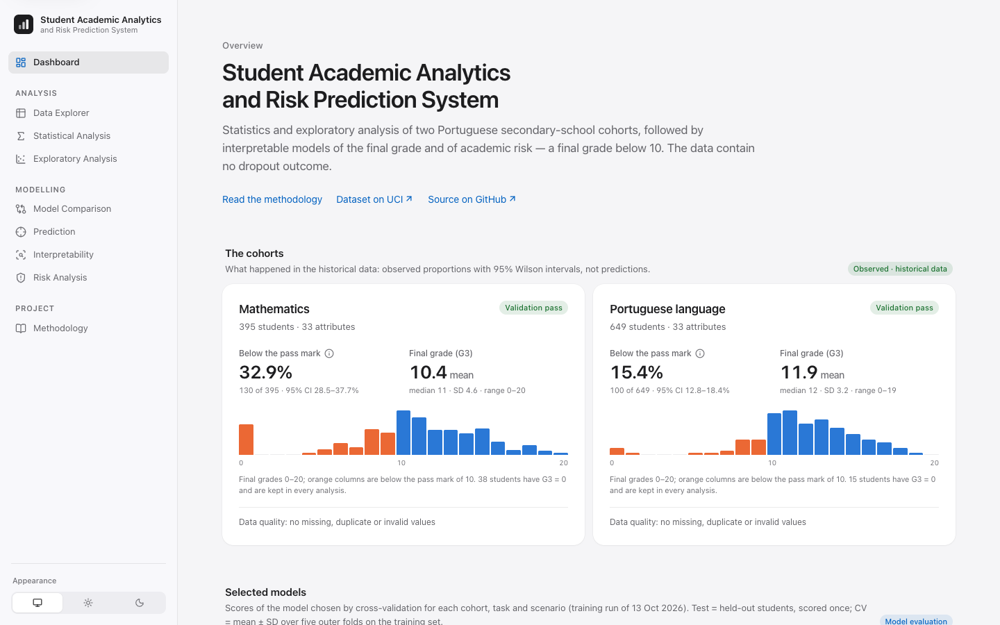
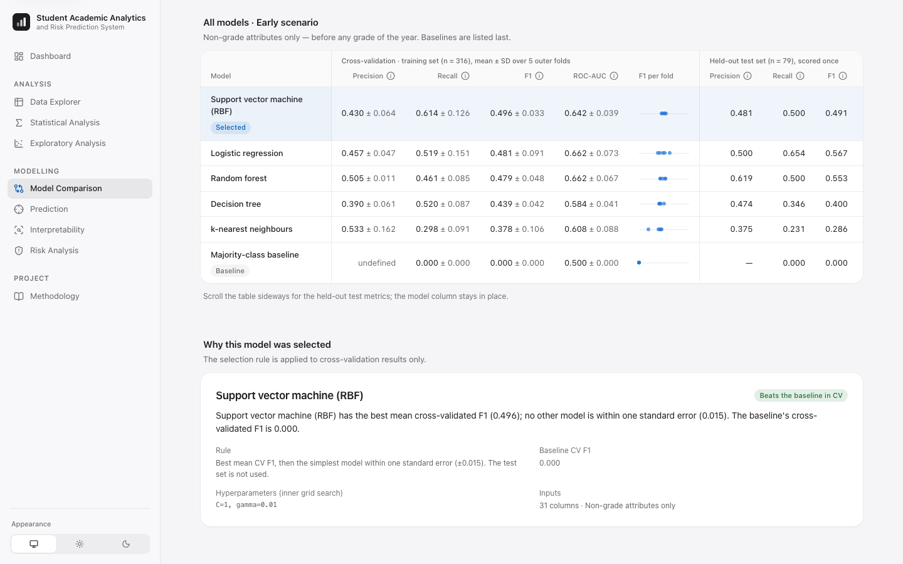
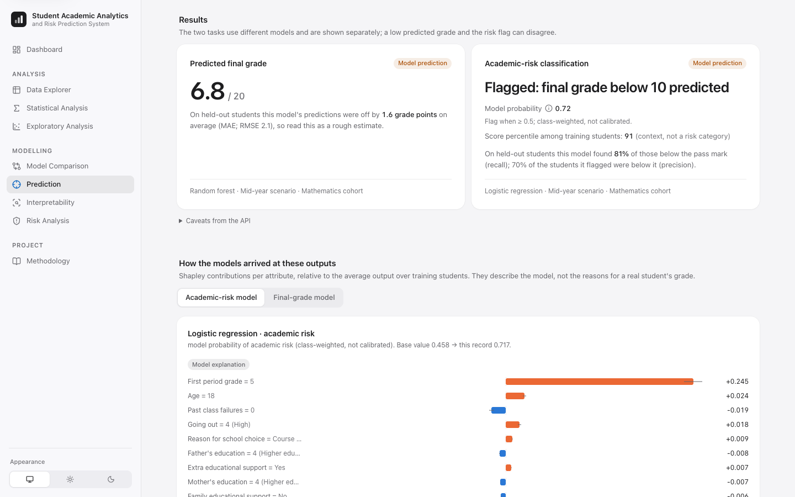
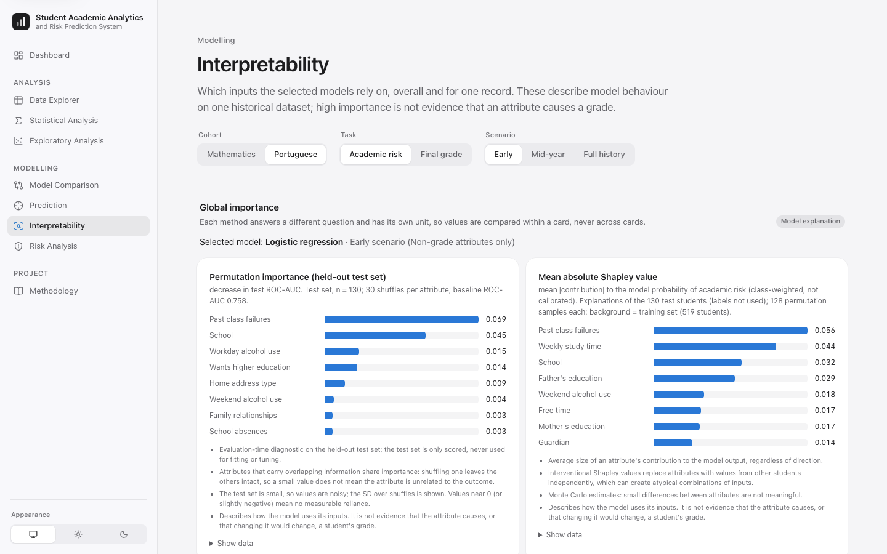
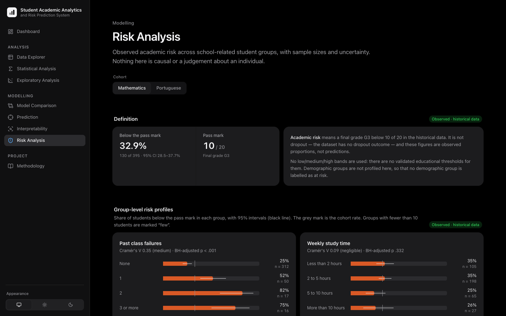
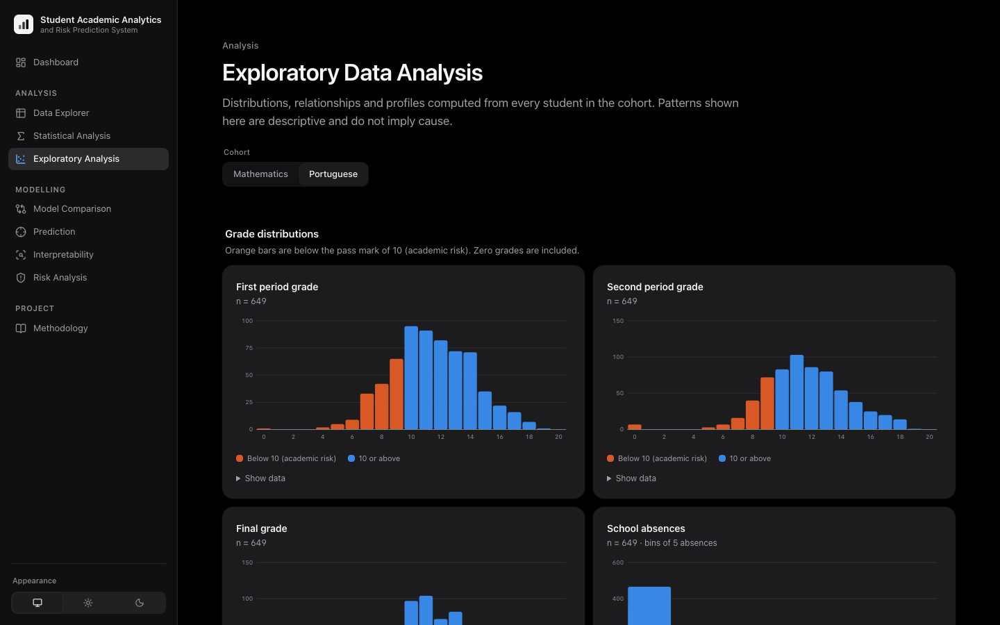
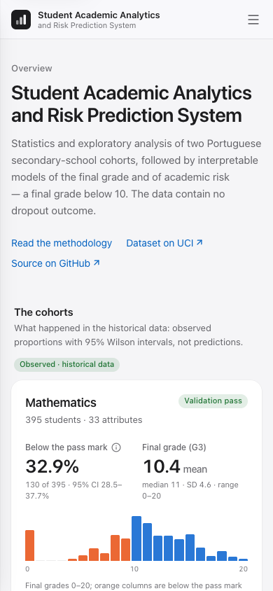

<p align="center">
  
</p>

<p align="center">
  <a href="https://github.com/soyebmohammad03-dev/Student-Academic-Analytics-and-Risk-Prediction-System/actions/workflows/ci.yml"></a>
  <a href="LICENSE"></a>
  
  
  
  
  
  <a href="https://archive.ics.uci.edu/dataset/320/student+performance"></a>
</p>

<p align="center">
  <b>A reproducible workflow from statistical understanding to interpretable academic-risk models — delivered as a working web application.</b>
</p>

An undergraduate AI & Data Analytics project (ISPA) built on the UCI Student Performance
dataset. It validates the data, answers nine pre-specified research questions with
assumption-checked statistics, explores the data visually, compares regression and
classification models under three information scenarios with nested cross-validation,
explains the selected models, and profiles **academic risk** — a final grade below 10.
The dataset has no dropout outcome, so the system never claims to predict dropout.

The contribution is the **integrated, reproducible workflow and its implementation**, not
the novelty of any single technique.

## Contents

[Problem](#problem-statement) · [Objectives](#research-objectives) ·
[Capabilities](#key-capabilities) · [Architecture](#system-architecture) ·
[Workflow](#analytical-workflow) · [Dataset](#dataset) · [Methodology](#methodology) ·
[Results](#results) · [Screenshots](#screenshots) · [Tech stack](#technology-stack) ·
[Repository](#repository-structure) · [Getting started](#getting-started) ·
[API](#api) · [Testing](#testing) · [Docs](#documentation) · [Limitations](#limitations-and-responsible-use) ·
[Future scope](#future-scope) · [Credits & licence](#credits-and-licence)

## Problem statement

Schools hold rich data on students' backgrounds, habits and grades, but it is rarely
analysed systematically, and students who struggle are often identified only after final
results are published. A system that shows *which* factors are associated with low
performance, and estimates *who* may fall below the pass mark while there is still time to
offer support, can inform earlier conversations — provided its evidence, uncertainty and
limits are stated honestly.

## Research objectives

1. Describe both student cohorts statistically and test which factors are associated with
   final performance, with effect sizes and multiple-comparison correction.
2. Explore academic, family, social and behavioural patterns visually.
3. Prepare the data with documented, leakage-free preprocessing.
4. Train and compare regression (final grade) and classification (academic risk) models
   against baselines, under early, mid-year and full-history information scenarios.
5. Explain the selected models globally and for individual records, and profile observed
   academic risk across school-related groups.
6. Deliver all results through an API and an accessible web interface.

## Key capabilities

| Area | What it does | Where |
| --- | --- | --- |
| Data quality | Checksum-pinned download; 33-column schema, codes and ranges validated; nothing deleted | Data Explorer · `analytics/data` |
| Statistics | 9 research questions; Welch / Mann–Whitney / ANOVA / Kruskal–Wallis / χ² / Fisher chosen by assumption checks; effect sizes with CIs; Holm and Benjamini–Hochberg | Statistical Analysis · `analytics/statistics` |
| EDA | Histograms, category bars, box plots, aggregated scatter plots, Spearman heatmap, risk profile, outlier screening | Exploratory Analysis |
| Machine learning | Baselines + 3 regression and 5 classification models; nested 5×5 CV; CV-only one-SE selection; held-out test scored once | Model Comparison · `analytics/ml` |
| Prediction | Validated form generated from the data dictionary; only the scenario's inputs; grade and risk shown separately | Prediction |
| Interpretability | Attribute-level Shapley explanations; permutation, Shapley, impurity and coefficient importance; calibration; sensitivity experiments | Interpretability · `analytics/interpret` |
| Academic risk | Observed group rates with Wilson CIs, two-way tables, evidence-checked suggestions for human review | Risk Analysis · `analytics/risk` |
| Integration | One cached pipeline, readiness checks, typed errors, structured logs | `analytics/pipeline.py` · [docs/API.md](docs/API.md) |

## System architecture



The API never downloads data or trains models; `GET /api/v1/ready` reports what is
missing and the command that fixes it. The frontend renders only API responses and shows
an explanatory state when a component is unavailable. Details:
[docs/ARCHITECTURE.md](docs/ARCHITECTURE.md).

## Analytical workflow

<p align="center"></p>

## Dataset

**UCI Student Performance** (ID 320), P. Cortez and A. M. G. Silva, licensed
[CC BY 4.0](https://creativecommons.org/licenses/by/4.0/) —
<https://archive.ics.uci.edu/dataset/320/student+performance>.

| Cohort | File | Students | Columns | Below the pass mark (G3 < 10) | G3 = 0 |
| --- | --- | --- | --- | --- | --- |
| Mathematics | `student-mat.csv` | 395 | 33 | 130 (32.9%) | 38 |
| Portuguese language | `student-por.csv` | 649 | 33 | 100 (15.4%) | 15 |

30 demographic, family, social and school attributes plus the period grades `G1`, `G2`
and the final grade `G3` (0–20). Both files pass every validation check; values such as
`G3 = 0` are kept and analysed, never removed. The files are not committed — one command
downloads and verifies them. Every attribute is documented in
[docs/DATA_DICTIONARY.md](docs/DATA_DICTIONARY.md).

**Reference paper.** Cortez, P., & Silva, A. M. G. (2008). *Using Data Mining to Predict
Secondary School Student Performance.* In A. Brito & J. Teixeira (Eds.), Proceedings of
the 5th Future Business Technology Conference (FUBUTEC 2008), pp. 5–12. Porto: EUROSIS.

## Methodology

The full, decision-by-decision account is in [docs/METHODOLOGY.md](docs/METHODOLOGY.md).

**Statistics.** Descriptive statistics with confidence intervals; Pearson or Spearman
correlation chosen by distribution; group comparisons chosen by normality and
equal-variance checks (Welch's t, Mann–Whitney U, ANOVA, Welch's ANOVA, Kruskal–Wallis)
with Tukey HSD, Games–Howell or Dunn post-hoc tests; χ² or Fisher's exact test for
categorical associations. Effect sizes (Cohen's d, η², rank-biserial r, Cramér's V) are
reported beside every p-value. The seven confirmatory tests are Holm-corrected;
exploratory families use Benjamini–Hochberg. Significance and effect size are reported
separately, and every finding is an association in observational data, never a cause.
Results: [docs/STATISTICAL_FINDINGS.md](docs/STATISTICAL_FINDINGS.md).

**Exploratory analysis.** Grade and attribute distributions, final grade by group (box
plots), aggregated scatter plots that size identical observations by count, a Spearman
heatmap, an at-risk vs not-at-risk profile and Tukey / z outlier screening (flagged, not
removed).

**Targets and leakage control.** Regression predicts `G3`; classification predicts
`at_risk = G3 < 10`. `G3` and `at_risk` are never inputs, a `ScenarioGuard` rejects any
column set that does not match its scenario, and imputers, encoders and scalers are
fitted inside training folds only.

**Prediction scenarios** — different amounts of information, not different model quality:

| Scenario | Inputs | When the prediction could be made |
| --- | --- | --- |
| Early | 30 non-grade attributes | Before any grade of the year |
| Mid-year | + `G1` | After the first grading period |
| Full history | + `G1` + `G2` | After the second grading period |

**Models and evaluation.** Mean / majority-class baselines; linear regression, decision
tree and random forest (regression); logistic regression, decision tree, k-NN, SVM (RBF)
and random forest (classification, balanced class weights where supported). A stratified
80/20 split (seed 42) holds out a test set. Nested cross-validation (5 outer × 5 inner
folds, bounded grid search) estimates performance on the training set; the selected model
has the best mean CV RMSE / F1, or is the simplest within one standard error of it. The
**test set never influences selection** and is scored once. Metrics: MAE, RMSE, R²;
precision, recall, F1, ROC-AUC, specificity and confusion matrices, always beside a
baseline.

**Interpretability.** Explanations are per original attribute. Individual explanations
use interventional Shapley values by permutation sampling (seeded, exactly additive, with
standard errors). Global importance is reported per method — held-out permutation
importance (plus a G3 > 0 variant), mean |Shapley|, impurity importance, coefficients —
each on its own scale and never compared across methods. Probabilities are shown only
where a model produces them and are labelled as class-weighted, not calibrated.
Sensitivity experiments vary one school-related attribute at a time and describe model
behaviour, not interventions. Results:
[docs/INTERPRETABILITY.md](docs/INTERPRETABILITY.md).

**Academic risk.** A final grade below the pass mark of 10. Group profiles report observed
proportions with 95% Wilson intervals for school-related attributes only (no demographic
group is labelled at risk); groups under 10 students are marked. No low / medium / high
bands are used, because no validated thresholds exist for them. Suggestions are general,
non-punitive prompts for a teacher or adviser, shown only when the cohort's data support
them.

## Results

The tables below are generated from the recorded training run (`models/ml_results.json`),
and the test suite checks that they still match it.

<!-- results:start (generated by `python -m analytics.ml.train --report-only`) -->

**Final grade (regression).** Lower RMSE/MAE is better; the baseline predicts the training mean.

| Cohort | Scenario | Selected model | CV RMSE (mean ± SD) | Test RMSE | Test MAE | Test R² | Baseline test RMSE |
| --- | --- | --- | --- | --- | --- | --- | --- |
| Mathematics | Full history | Random forest | 1.72 ± 0.40 | 1.26 | 0.82 | 0.92 | 4.60 |
| Mathematics | Mid-year | Random forest | 2.57 ± 0.29 | 2.15 | 1.60 | 0.78 | 4.60 |
| Mathematics | Early | Random forest | 3.88 ± 0.32 | 3.94 | 2.88 | 0.27 | 4.60 |
| Portuguese | Full history | Linear regression | 1.25 ± 0.26 | 1.45 | 0.85 | 0.83 | 3.56 |
| Portuguese | Mid-year | Linear regression | 1.77 ± 0.37 | 2.03 | 1.34 | 0.67 | 3.56 |
| Portuguese | Early | Linear regression | 2.61 ± 0.22 | 3.10 | 2.22 | 0.24 | 3.56 |

**Academic risk (classification, positive class = G3 < 10).** The majority-class baseline has recall 0 and F1 0.

| Cohort | Scenario | Selected model | CV F1 (mean ± SD) | Test F1 | Test recall | Test precision | Test ROC-AUC |
| --- | --- | --- | --- | --- | --- | --- | --- |
| Mathematics | Full history | Decision tree | 0.89 ± 0.03 | 0.84 | 0.92 | 0.77 | 0.95 |
| Mathematics | Mid-year | Logistic regression | 0.75 ± 0.07 | 0.75 | 0.81 | 0.70 | 0.93 |
| Mathematics | Early | Support vector machine (RBF) | 0.50 ± 0.03 | 0.49 | 0.50 | 0.48 | 0.69 |
| Portuguese | Full history | Random forest | 0.77 ± 0.05 | 0.65 | 0.85 | 0.53 | 0.94 |
| Portuguese | Mid-year | Logistic regression | 0.67 ± 0.10 | 0.64 | 0.85 | 0.52 | 0.90 |
| Portuguese | Early | Logistic regression | 0.51 ± 0.05 | 0.44 | 0.55 | 0.37 | 0.76 |

Training run of 2026-10-13; held-out test sets of 79 (Mathematics) and 130 (Portuguese) students. Full tables, folds and error analysis: [docs/ML_RESULTS.md](docs/ML_RESULTS.md).

<!-- results:end -->

**How to read them.** Period grades correlate strongly with the final grade, so the
full-history models mostly reuse interim grades; their scores reflect information, not
insight. The **early** scenario is the realistic one for early support, and there the
models are modest: the selected classifiers found about half of the held-out students who
finished below the pass mark (recall 0.50 and 0.55). Every selected model beats its
baseline in cross-validation, and test sets of 79 and 130 students make the test figures
noisy.

## Screenshots

Captured from the running application with the real dataset and trained models
(`node scripts/screenshots.mjs`).

| Dashboard | Model comparison |
| --- | --- |
|  |  |
| **Prediction** | **Interpretability** |
|  |  |
| **Risk analysis (dark theme)** | **Exploratory analysis (dark theme)** |
|  |  |

<p align="center"></p>

## Technology stack

| Layer | Tools |
| --- | --- |
| Analytics | Python 3.12, pandas, NumPy, SciPy, scikit-learn, joblib |
| API | FastAPI, Pydantic v2, pydantic-settings, Uvicorn |
| Interface | Next.js 16 (App Router), React 19, TypeScript, Tailwind CSS 4, lucide-react |
| Quality | pytest, Ruff, ESLint, Vitest, Testing Library, axe-core, GitHub Actions |

## Repository structure

```
├── backend/
│   ├── analytics/            # framework-independent analysis package
│   │   ├── data/             # download, checksums, dictionary, validation, overlap
│   │   ├── preprocessing/    # targets, scenarios, ScenarioGuard, encoders, split
│   │   ├── statistics/       # tests, effect sizes, corrections, EDA aggregates, findings
│   │   ├── ml/               # registry, nested CV, selection, persistence, prediction, reports
│   │   ├── interpret/        # Shapley, importance, calibration, sensitivity, report
│   │   ├── risk/             # group profiles, evidence-checked suggestions
│   │   └── pipeline.py       # AnalyticsPipeline: caching, readiness, summaries
│   ├── app/                  # FastAPI: routes, schemas, services, errors, logging
│   └── tests/                # pytest (synthetic data; real-data tests skip without data)
├── frontend/src/
│   ├── app/                  # one route per page
│   ├── components/           # layout, ui, charts and one folder per page
│   └── lib/                  # typed API client, hooks, shared state, form rules
├── data/raw/                 # downloaded UCI files (git-ignored)
├── models/                   # trained artefacts (git-ignored, regenerated)
├── docs/                     # methodology, results, API, architecture, assets
├── scripts/                  # check.sh, screenshots.mjs
└── .github/workflows/ci.yml  # lint, tests and build on every push
```

## Getting started

**Prerequisites:** Python 3.11+ (3.12 recommended), Node.js 20.9+ and npm, git.
[uv](https://docs.astral.sh/uv/) is optional.

```bash
git clone https://github.com/soyebmohammad03-dev/Student-Academic-Analytics-and-Risk-Prediction-System.git
cd Student-Academic-Analytics-and-Risk-Prediction-System
```

**1. Backend environment**

```bash
cd backend
python3.12 -m venv .venv && source .venv/bin/activate   # or: uv venv --python 3.12 .venv
pip install -e ".[dev]"                                  # or: uv pip install -e ".[dev]"
```

**2. Dataset** — downloads the official UCI archive and verifies SHA-256 checksums
(a few seconds; the only step that needs the network):

```bash
python -m analytics.data.download
```

**3. Models and interpretability** — offline and deterministic (seed 42); about 9 minutes
and 1 minute on a recent laptop:

```bash
python -m analytics.ml.train          # trains, evaluates and saves the 12 selected pipelines
python -m analytics.interpret.build   # global importance and calibration
```

**4. Start the API and the interface** (two terminals):

```bash
cd backend && source .venv/bin/activate && uvicorn app.main:app --port 8000
```

```bash
cd frontend && npm install && npm run dev
```

Open <http://localhost:3000>. `curl -s localhost:8000/api/v1/ready` should report
`"ready"`; otherwise it names the missing component and the command that restores it.
Optional settings (`SAARPS_DATA_DIR`, `SAARPS_MODELS_DIR`, `SAARPS_CORS_ORIGINS`,
`SAARPS_LOG_LEVEL`) are listed in `backend/.env.example`; the frontend's API URL is set by
`NEXT_PUBLIC_API_BASE_URL` (`frontend/.env.example`).

A verified fresh-clone run of these steps, and how to regenerate every generated document,
is described in [docs/REPRODUCIBILITY.md](docs/REPRODUCIBILITY.md).

## API

Base URL `http://localhost:8000/api/v1`; interactive OpenAPI docs at
<http://localhost:8000/docs>. Every error has the body `{"code", "detail"}`, without paths
or stack traces.

| Group | Endpoints |
| --- | --- |
| System | `GET /health`, `/ready`, `/project`, `/dashboard/summary`, `/pipeline/summary` |
| Dataset | `GET /dataset/{summary,schema,quality,records,overlap}`, `/preprocessing/summary` |
| Statistics & EDA | `GET /statistics/{descriptive,distributions,correlations,hypothesis-tests,group-comparisons,associations,outliers}`, `/eda/charts` |
| Models | `GET /models`, `/models/{regression,classification,evaluations,scenario-comparison,cohort-comparison,selected}`, `POST /models/predict` |
| Interpretability | `GET /interpretability/importance`, `POST /interpretability/{explain,sensitivity,scenario-sensitivity}` |
| Risk | `GET /risk/profiles`, `POST /risk/{suggestions,insights}` |

Request and response examples, error codes and measured timings:
[docs/API.md](docs/API.md).

## Testing

```bash
./scripts/check.sh
```

Runs Ruff (lint and format), pytest, ESLint, TypeScript, Vitest (including axe-core
accessibility checks) and a production build. Tests use synthetic data and need no
network. Tests that need the official files or trained artefacts skip themselves when
those are absent; once they exist, they also check that the generated documents and this
README's results match the artefacts. The same checks run in
[GitHub Actions](.github/workflows/ci.yml) on every push, without downloading data or
training models.

## Documentation

| Document | Contents |
| --- | --- |
| [METHODOLOGY.md](docs/METHODOLOGY.md) | Every analytical decision, its rationale and limitations |
| [STATISTICAL_FINDINGS.md](docs/STATISTICAL_FINDINGS.md) | Research questions, tests and effect sizes (generated) |
| [ML_RESULTS.md](docs/ML_RESULTS.md) | All models, folds, selections and error analysis (generated) |
| [INTERPRETABILITY.md](docs/INTERPRETABILITY.md) | Importance, calibration and risk profiles (generated) |
| [DATA_DICTIONARY.md](docs/DATA_DICTIONARY.md) | The 33 attributes and their codes (generated) |
| [ARCHITECTURE.md](docs/ARCHITECTURE.md) | Components, diagrams, data flow and security posture |
| [API.md](docs/API.md) | Endpoints, examples, error codes and timings |
| [REPRODUCIBILITY.md](docs/REPRODUCIBILITY.md) | Fresh-clone procedure and regeneration commands |
| [ACCESSIBILITY.md](docs/ACCESSIBILITY.md) | Accessibility checks and browser coverage |
| [PROJECT_ROADMAP.md](PROJECT_ROADMAP.md) | What each of the nine phases delivered |

## Limitations and responsible use

- **Scope of the data.** Two Portuguese schools in 2005–2006; results may not transfer to
  other schools, years or education systems.
- **Observational, cross-sectional data.** Associations and model reliance are not causes;
  sensitivity experiments describe model behaviour, not interventions.
- **No dropout outcome.** The system estimates academic risk (G3 < 10) and never claims to
  predict dropout.
- **Modest early prediction.** Without period grades, the selected classifiers missed about
  half of the held-out at-risk students. A missing flag is not evidence that a student is
  fine.
- **Uncalibrated probabilities.** Class-weighted probabilities order students; they are
  not the chance of failing.
- **Small test sets** (79 and 130 students) make test metrics, importance and calibration
  noisy. `G3 = 0` probably sometimes means the final assessment was not taken.
- **Local academic prototype.** No authentication, authorisation or rate limiting; CORS is
  restricted to the configured origin. Do not deploy it publicly without adding them.

Predictions and suggestions are for educational analysis and discussion between a student
and a teacher or adviser. They do not determine a student's ability or future, must not be
used for automated, disciplinary or high-stakes decisions, and no demographic group is
labelled as at risk.

## Future scope

- Validation on more recent cohorts or other schools — and a dataset with a genuine
  dropout outcome before any dropout claim.
- Probability calibration on a separate calibration set, and a decision threshold informed
  by the real cost of an intervention.
- A fairness analysis across sensitive attributes, with its methodology documented first.
- Authentication, rate limiting and audit logging before any deployment beyond a local
  machine.

## Credits and licence

- **Author:** Soyeb Mohammad — ISPA undergraduate AI & Data Analytics project.
- **Data:** P. Cortez and A. M. G. Silva, UCI Machine Learning Repository, CC BY 4.0. The
  data are not redistributed here; attribution is required when using them.
- **Reference:** Cortez & Silva (2008), cited above.
- **Software licence:** [MIT](LICENSE). It covers the code only, not the dataset (see [NOTICE](NOTICE)).

Project history and phase-by-phase scope: [PROJECT_ROADMAP.md](PROJECT_ROADMAP.md).
